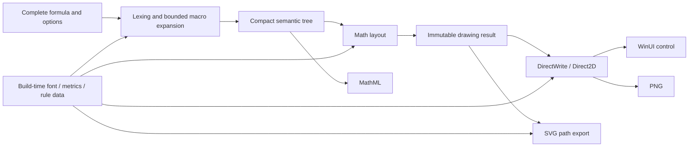

# VelociTex Architecture and Interface Design

English | [中文](architecture.zh-CN.md)

This document describes the target architecture. P1 now implements compact semantics, basic math layout, independent immutable results and native/PNG/SVG/MathML output. The current API and ownership boundaries are documented in [p1-api.md](p1-api.md), with actual verification and limits in the [P1 record](verification/p1-2026-10-19.md). Some sketches below still describe later target APIs. The selected native route is recorded in [ADR 0001](decisions/0001-native-rendering.md). Requirements are in [Requirements and Scope](requirements.md), and phase deliverables are in the [Roadmap](roadmap.md).

## 1. Pipeline and Modules



The runtime never builds HTML, CSS, or a DOM. It keeps KaTeX's semantics, TeX math spacing, style switching, symbol construction, and layout relationships, and projects those relationships directly into layout data and drawing instructions. CSS does influence the reference result, so ignoring it is not automatically equivalent.

Start with three packages only, instead of splitting the first version into many micro-packages:

| Package / Project | Responsibility | Dependency Boundary |
| --- | --- | --- |
| `VelociTex.Core` | Options, diagnostics, lexing, macros, semantic tree, math layout, drawing results, MathML, embedded KaTeX data and font resources | `net10.0`; no dependency on WinUI / COM / browser |
| `VelociTex.Rendering.Direct2D` | Private font collection, text shaping, glyph drawing, paths, off-screen PNG and SVG glyph outlines | Windows 10 19041+; depends on Core and selected bindings |
| `VelociTex.WinUI` | `MathView`, theme / DPI, copy, basic AutomationPeer, drawing surface lifecycle | Depends on first two packages and actually locked WinUI |

`tools/` holds upstream list extraction, data generation, and differential tooling; `tests/` splits into semantic, layout, export, and native integration; `benchmarks/` splits into core and host; `samples/` holds the native acceptance app. Any later mixing layer stays optional: the math core must not depend on paragraphs or downstream domain models.

## 2. Upstream Data and Reproducible Generation

The source is the commit and npm package recorded in the [lock file](reference/katex-0.19.0.lock.json): verify the checksums first, then use the content. Source code and distribution packages from other versions must never be mixed in.

Items to generate or extract:

- Stable IDs and metadata for commands, symbols, Unicode mappings, environments, built-in macros.
- Glyph height, depth, width, italic correction, skew; math constants for different sizes / styles.
- Math atom spacing tables, style conversion, font selection, and stretchy symbol parameters.
- Font files, code point → glyph mapping, stretchy path geometry and path parameters.
- Source files, source checksums, generator version, and final data checksums.

Font metrics based on [fontMetricsData](https://github.com/KaTeX/KaTeX/blob/v0.19.0/src/fontMetricsData.js) and [fontMetrics](https://github.com/KaTeX/KaTeX/blob/v0.19.0/src/fontMetrics.ts); stretchy geometry references [svgGeometry](https://github.com/KaTeX/KaTeX/blob/v0.19.0/src/svgGeometry.ts) and [stretchy](https://github.com/KaTeX/KaTeX/blob/v0.19.0/src/stretchy.ts).

Generators use the TypeScript AST or controlled registry loading to extract metadata; they must not guess at dynamically registered commands with regular expressions. Complex macros and layout functions are implemented as hand-written C# rules, because not every JS function can be turned into static data automatically. Generated tables are signed and compared item by item in differential testing, so that rule changes cannot be hidden behind modified font metrics.

The generated data and the generation tools are both committed. Ordinary NuGet consumers install no Node.js, browser, Python, TeX, or FontForge; development dependencies are only needed for upstream updates and data regeneration. Generation output must be deterministic, and CI rebuilds compare checksums.

The code is MIT licensed. The name tables of the 20 TTF files in the distribution package declare OFL-1.1 and Reserved Font Names, as recorded in the lock file. The first version keeps the font bytes unchanged and ships the KaTeX MIT license, the original OFL font text with copyright and reserved names, and third-party notices as separate items. The font license is never replaced by this library's MIT license.

## 3. Data Model and Ownership

### 3.1 Hot Path Data

| Data | Suggested Representation |
| --- | --- |
| Token | Value type of `kind + sourceId + start + length + commandId`; pull by token as needed |
| Macro Expansion | Compact token segments, parameter segments, expansion frame stack; replacement segments reference original source text or macro definition source text |
| Semantic Node | Compact struct array with tags, referencing specialized payload by type; child nodes store indices or continuous ranges |
| Layout State | Value type style / size / font / color / cramped state, propagated via explicit stack |
| Layout Result | Advance, height, depth, position, and ink bounds per node index |
| Drawing Instructions | Ordered opcode array, payload referencing continuous glyph / path / transform data |
| Diagnostics | Stable error codes, source ranges, and necessary parameters; natural language messages formatted on-demand in error paths |

Do not create a class per token, atom, or span, and do not use LINQ, `Substring`, reflection, dynamic objects, or delegate-registered dispatch on the hot path. Command recognition uses generated string span lookup, a trie, or a static hash, always with a real name comparison so that collisions cannot slip through.

Start with compact AoS nodes whose payload is separated by category: that is already data-oriented design. Split into SoA only where profiling shows that traversing specific columns pays off. Do not collapse all nodes into one giant union for the sake of "zero allocation" if that instead worsens cache bandwidth and result memory.

### 3.2 Lifecycle

- `MathEngine` rules and tables are read-only and safe to use concurrently; mutable scratch state lives in the call-exclusive `MathWorkspace`.
- After compilation, `MathDocument` owns independent, immutable semantic and drawing data and keeps the source text it needs. Temporary arena indices and `Span`s never escape.
- First-version results use precisely sized managed arrays held by sealed reference types; the public API does not expose complex borrowing rules just to save one allocation.
- `MathWorkspace` reuses only temporary token, stack, and layout buffers. Growth is bounded: a huge request must not permanently pin its high-water capacity.
- `PreparedMath` and other platform resource objects may implement `IDisposable` and explicitly own font faces, glyph caches, and device resources; controls and caches own their lifetimes.
- Concurrent read-only drawing is allowed, but platform resources must not race unprotected against disposal or device reset.
- If results are pooled later, add explicit lease types and tests; the existing result lifetime must not change silently.

"Zero allocation" is a goal for later stages of workspace reuse and non-growing internal computation. Input, immutable results, error messages, export bytes, and device / COM allocations are measured separately, so no claim of absolute zero allocation across the whole API.

## 4. Lexing, Macros, and Validation

Use a backtracking token stream with explicit expansion frames; grouping, arguments, and environments are handled by bounded stacks. Diagnostics use UTF-16 source offsets, while Unicode scalars are processed as whole `Rune`s so a surrogate pair is never split into two symbols.

The macro system covers string macros, arguments, definition and assignment, local scopes, and the global definitions the fixed version core requires. Built-in behavior macros are implemented as stable opcodes. The first version does not open arbitrary C# or JS callback macros.

By default every formula has isolated macro state; an explicit `MacroSession` allows consecutive definitions to share state within the same trusted document. A session is used serially: compilation works on a snapshot plus a write set, commits on success, and leaves the session untouched on error or cancellation. That rollback behavior is an explicit part of the native API contract, and any difference from upstream failure side effects must be recorded.

While macro sessions exist, cache hits must also account for state changes. The first version simply forbids caching results for inputs that carry write operations or share mutable sessions; later versions may cache verified read and write sets. `\gdef` results can never be reused on the basis of the LaTeX string alone.

Validation and parsing happen in a single pass; a full `Validate` followed by a second `Parse` is not acceptable. Ordinary invalid input returns structured diagnostics, and the `Compile` convenience entry turns failures into exceptions. Unclosed delimiters belong to the host's body-text scanning; the single-formula API receives content with the outer `$...$` or `\(...\)` removed and an explicit displayMode.

P0 starts from these configurable protection points: 32,768 UTF-16 units of input, 65,536 expanded tokens, 65,536 semantic nodes, nesting depth 128 for groups and environments, 4,096 matrix cells, and 1,000 macro expansions by default. Exceeding a limit returns a diagnostic; P0 calibrates these values against the corpus and publishes them as configuration. External resource access is forbidden: no user files, network requests, or scripts are executed.

Options and geometric values must be finite at every step; NaN, Infinity, integer size overflow, and unacceptably large canvases are rejected. Cancellation is checked in token and macro batches, matrix rows, and instruction generation batches, not only at the entry point.

## 5. Math Layout

Rules that must be retained:

1. Display / Text / Script / ScriptScript and cramped states, size levels and font mappings.
2. Ord / Op / Bin / Rel / Open / Close / Punct / Inner atom types, Bin reclassification in context, and spacing.
3. Minimum shifts and gaps for superscripts / subscripts, italic correction, limits with large operators.
4. Fractions, no-line fractions, generalized fractions, binomials, radicals, and math axis.
5. Fixed-size and spliceable delimiters, `\left` / `\middle` / `\right`, stretchy arrows, accents, and braces.
6. Matrix and array column spacing, alignment, row spacing, rule lines; cases, aligned, gather, core CD environments.
7. Font / bold / color / text, explicit units and spacing, phantom / smash / lap / raisebox special box semantics.
8. Labels, numbering, and related options; explicitly note impact of host-available width on their position.

Implementation based on corresponding function files, [spacingData](https://github.com/KaTeX/KaTeX/blob/v0.19.0/src/spacingData.ts), [Style](https://github.com/KaTeX/KaTeX/blob/v0.19.0/src/Style.ts), [units](https://github.com/KaTeX/KaTeX/blob/v0.19.0/src/units.ts), and CSS rules that actually change geometry. Internal calculations first use double to stay close to JS numeric values; convert to float only when submitting to drawing API. First version does not use fixed-point or per-stage pixel rounding.

### 5.1 Size Contract

- `FontSizeDip` represents formula's own effective em size, 1 DIP = 1/96 inch. When comparing with browser, cancel KaTeX outer default 1.21× scaling to avoid double scaling.
- Internal math coordinates in em units, baseline at y=0, right / down positive; results explicitly give logical size, baseline, and ink bounds.
- Simultaneously retain advance width, height / depth, ink bounds. Negative spacing, italic overhang, lap, and phantom cannot be represented by single rectangle.
- Default typeset at natural width; no automatic font size compression, truncation, or arbitrary formula splitting. Line breaks within environments retained.
- `ContainerWidthDip` only for labels, specified alignment, and host context; does not imply paragraph automatic line breaking. When width missing but labels present, measure body / tag natural width then layout with explicit native default container width; P0 freezes that width and label gap, comparing with KaTeX fixture of same width.
- External display paragraph top / bottom margins determined by host; cannot mix into formula internal baseline and logical height.

### 5.2 Glyphs and Text

Known math symbols use fixed fonts and explicit glyph positions; do not give entire formula to DrawText or generic OpenType MATH engine for re-typesetting. Whether KaTeX metrics and actual TTF advance are consistent needs P0 verification; when differences exist, determine compatibility rules based on browser measurement, not arbitrarily switch to system font measurement.

`\text{...}`, Unicode fallback, and complex text are delegated to DirectWrite through the `ITextShaper` interface, which produces reusable glyph runs; math symbol layout stays under the core's control. Math glyphs that are already positioned do not get automatic kerning or ligatures reapplied. Font switching, ligatures, combining characters, and text fallback are verified separately.

System fallback fonts are not bundled. The English and math corpus uses the locked fonts; Chinese fallback is compared on machines with the same Windows build and font list, recording the fonts actually used and the platform differences.

## 6. Native Rendering and Export

### 6.1 DirectWrite / Direct2D

Fonts loaded via private font collection, no global installation required. Font file or embedded memory owner must outlive corresponding font face. DirectWrite supports [custom font collections](https://learn.microsoft.com/en-us/windows/win32/directwrite/custom-font-sets-win10), Direct2D's [DrawGlyphRun](https://learn.microsoft.com/en-us/windows/win32/api/d2d1/nf-d2d1-id2d1rendertarget-drawglyphrun) accepts explicit glyph information.

Display results emit glyph runs, solid horizontal lines / rectangles, paths, transforms, and clips in original drawing order. Can only merge adjacent runs with same state; must not reorder across color, occlusion, or overlap relationships to reduce calls.

P0 first validates the system D2D / DirectWrite lightweight bindings together with a WinUI Composition drawing surface. If the interop or AOT maintenance cost turns out to be unsuitable, compare a Win2D surface adapter and then lock the choice once; do not keep two parallel backends long term. Win2D is an optional interface built on Direct2D, but its specific version, WinUI version, and AOT publishing must be tested directly — compatibility cannot be concluded from a [general introduction](https://learn.microsoft.com/en-us/windows/apps/develop/win2d/).

Device resources managed per device / thread context. Fonts, semantics, and geometry decoupled from GPU device as much as possible; after device loss, rebuild display resources, do not force re-parsing. Provide WARP / software path for no-GPU environments and baselines, recording differences from hardware path.

### 6.2 PNG

The same drawing result goes to an off-screen D2D target and is then encoded to PNG with WIC. Transparent backgrounds, caller colors, DPI, scaling, and padding are supported; the export entry writes to a `Stream`, while the `byte[]` convenience entry allocates its own output buffer.

The canvas is computed from the union of the logical box and the ink bounds, then expanded by the padding, and the translated baseline is recorded. Edges are handled with pixel floor and ceil instead of changing internal geometry. Verify premultiplied alpha, edges on dark backgrounds, and that superscripts, subscripts, and radicals are not clipped.

The initial maximum export size is 4,194,304 pixels with no side above 8,192 pixels, computed with checked arithmetic, and the limits are configurable. The memory used by the off-screen drawing, the readback, and the encoding all count toward the export budget.

### 6.3 SVG

The default output is a self-contained SVG of paths, generated from the same drawing instructions through fixed font glyph outlines, so it does not depend on KaTeX fonts being installed on the client. Glyph outlines are lazy-loaded into a bounded cache; shared `defs` plus `use` are preferred and repeated glyphs are written once.

Keep the viewBox, a transparent background, explicit size, color, and the accessibility metadata that is needed; escape text and attributes as XML. No external `href`, scripts, external fonts, or arbitrary raw XML injection; `use` may only reference definitions inside the same SVG.

SVG gets its font outlines on Windows, so SVG export belongs to the Windows rendering package and Core stays free of COM. Cross-platform SVG was not requested for the first version. Whether to add a pre-generated outline package without native calls is left open until package size and performance data support it.

### 6.4 MathML

Emit Presentation MathML directly from the retained semantic tree, following [buildMathML](https://github.com/KaTeX/KaTeX/blob/v0.19.0/src/buildMathML.ts) and its builder; never reverse-engineer it from glyphs or SVG.

The default output carries the namespace and an optional `semantics / annotation encoding="application/x-tex"` with the original text, and expresses scripts, limits, fractions, tables, and text correctly. Browser-specific branches are not emitted, and purely internal auxiliary nodes take separate visual and semantic branches.

The first version compares normalized XML trees; byte-identical serialization, attribute order, and quoting style are not goals. When another reader renders the MathML, the appearance is that reader's business, so its screen output is never used as proof of this library's SVG / PNG geometric consistency.

## 7. API Shape (Design Draft)

The sketch below pins down target responsibilities. P1 implements MathEngine/MathWorkspace/MathDocument, WindowsMathRenderer/PreparedMath and MathMlWriter; the actual signatures are in [p1-api.md](p1-api.md). PNG/SVG methods currently live on WindowsMathRenderer, and MathView binds a Result. Source binding and API stabilization remain P2 work.

```csharp
// Each formula parsed once; errors return stable diagnostics.
bool MathEngine.TryCompile(
    string latex,
    in MathOptions options,
    MathWorkspace workspace,
    CancellationToken cancellationToken,
    out MathDocument? document,
    out MathDiagnostic diagnostic);

// Immutable result: Source, LogicalSize, BaselineDip, InkBounds, Diagnostics.
// Draw / Prepare consume same result; SVG string not used as native display intermediate.
PreparedMath WindowsMathRenderer.Prepare(MathDocument document);
void WindowsMathRenderer.Draw(PreparedMath result, NativeDrawingContext target);
void WindowsMathExporter.WritePng(MathDocument document, Stream output, PngOptions options);
void WindowsMathExporter.WriteSvg(MathDocument document, Stream output, SvgOptions options);
void MathMlWriter.Write(MathDocument document, Stream output, MathMlOptions options);
```

Ordinary calls rent a workspace from the engine automatically, while high-throughput callers can reuse one explicitly. The synchronous core API does not create a `Task` per formula; batching, scheduling, cancellation, and UI generation control belong to the host service. Output carries size and baseline metadata, so the downstream host never has to re-measure an SVG or PNG.

`MathView` exposes at least Source / Result, DisplayMode, FontSize, Foreground, AccessibleDescription, and an error display strategy; it can compile from Source or bind an already compiled result. Colors come from the drawing theme by default, while explicit colors inside the math are kept as drawing state.

## 8. Caching, Scheduling, and Engineering Quality

Keep separate caches for source text / macro snapshots, compilation results, text shaping, glyph outlines, and device resources. Keys must cover typesetting options, font and data version, macro state, and the text fallback environment. DPI and theme usually affect drawing only, so keep them out of semantic keys where possible, but never drop explicit color commands, sizes, or widths. Hash equality is not enough — compare the complete key.

A first-pass budget of 16MiB of cache per engine is suggested, with at most two workspace buffers reused, and no single buffer above roughly 1MiB retained long term. These are engineering budgets to calibrate in P0, not user-specified values. Platform caches are counted in the same resource ledger, with GPU surfaces listed separately. The host queue defaults to at most two compilation workers, cancels stale requests, and forbids unbounded `Task.Run` or unbounded request queues.

Public APIs are conventional, typed, and XML documented; `unsafe` is limited to necessary native boundaries and measured hot spots. Use centrally managed package versions, locked restore, nullable reference types, analyzers, deterministic builds, SourceLink, and package validation. No runtime reflection, no dynamic code generation, and no suppressed AOT warnings: publish and run a real AOT consumer program to verify the whole chain.

Native entries prefer source-generated P/Invoke; COM chooses static generation / explicit vtable binding, or verified GeneratedComInterface / ComWrappers path. Managed callbacks like font loader, outline sink, and inline object also verify AOT, not depending on runtime-generated traditional COM stubs. Reference at [.NET Native AOT interop](https://learn.microsoft.com/en-us/dotnet/core/deploying/native-aot/interop) and [COM source generation documentation](https://learn.microsoft.com/en-us/dotnet/standard/native-interop/comwrappers-source-generation).

Later optimization follows this order: measure hotspots → improve data layout and copying → cache expensive stable data → batch drawing → reduce native calls → only then consider SIMD. Each step is gated on correctness, memory, AOT, and old-CPU regression.
