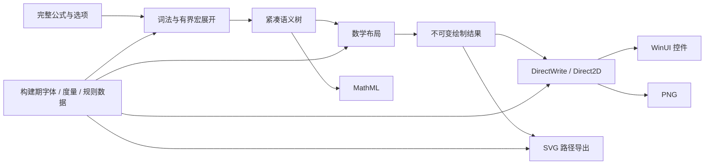

# VelociTex 架构与接口设计

[English](architecture.md) | 中文

本文件描述目标架构。P2 已扩展紧凑语义和独立不可变结果，包含常用算符、矩阵、伸缩路径、真实系统字体 CJK 轮廓及有界结果缓存；原生/PNG/SVG/MathML 和隔离本地 NuGet 消费者均已实际运行。基础接口见 [p1-api.md](p1-api.md)，新增接口、实测和限制见 [P2 记录](verification/p2-2026-10-19.md) 与 [包契约](package-contract.md)。下文部分草图仍是后续目标接口，原生选型见 [ADR 0001](decisions/0001-native-rendering.md)。

## 1. 管线与模块



运行时不构造 HTML / CSS / DOM。它保留 KaTeX 的语义、TeX 数学间距、样式切换、符号构造和布局关系，并把这些关系直接投影为布局数据与绘制指令。CSS 会影响对照结果，因此忽略 CSS 并不自动等价。

首版只公开三个包，避免拆成过多微型包：

| 包 / 工程 | 责任 | 依赖边界 |
| --- | --- | --- |
| `VelociTex.Core` | 选项、诊断、词法、宏、语义树、数学布局、绘制结果、MathML、嵌入式 KaTeX 数据和字体资源 | `net10.0`；不依赖 WinUI / COM / 浏览器 |
| `VelociTex.Rendering.Direct2D` | 私有字体集、文本 shaping、字形绘制、路径、离屏 PNG 和 SVG 字形轮廓 | Windows 10 19041+；依赖 Core 与选定绑定 |
| `VelociTex.WinUI` | `MathView`、主题 / DPI、复制、基础 AutomationPeer、绘制表面生命周期 | 依赖前两包与实际锁定的 WinUI |

`tools/` 放上游清单提取、数据生成和差分工具；`tests/` 分语义、布局、导出和原生集成；`benchmarks/` 分核心与宿主；`samples/` 放原生验收程序。后续混排层必须是可选层，数学核心不能依赖段落或下游领域模型。

## 2. 上游数据和可重复生成

以 [锁定清单](reference/katex-0.19.0.lock.json) 记录的提交和 npm 包为源：先核验摘要，再使用内容。源码和发行包不与其他版本混用。

需要生成或提取：

- 命令、符号、Unicode 映射、环境、内置宏的稳定 ID 与元数据。
- 字形高度、深度、宽度、斜体修正、skew；不同大小 / 样式的数学常量。
- 数学原子间距表、样式转换、字体选择和伸缩符号参数。
- 字体文件、code point → glyph 映射、伸缩路径几何与路径参数。
- 来源文件、来源摘要、生成器版本和最终数据摘要。

字体度量以 [fontMetricsData](https://github.com/KaTeX/KaTeX/blob/v0.19.0/src/fontMetricsData.js) 和 [fontMetrics](https://github.com/KaTeX/KaTeX/blob/v0.19.0/src/fontMetrics.ts) 为依据；伸缩几何参照 [svgGeometry](https://github.com/KaTeX/KaTeX/blob/v0.19.0/src/svgGeometry.ts) 和 [stretchy](https://github.com/KaTeX/KaTeX/blob/v0.19.0/src/stretchy.ts)。

生成器用 TypeScript AST 或受控注册表加载提取元数据，不用正则猜测全部动态注册的命令。行为复杂的宏和布局函数由 C# 手写规则实现，因为并非所有 JS 函数都能自动转成静态数据。生成表逐项签名并做差分比对，规则变更不能靠改动字体度量来掩盖。

生成后的稳定数据与生成工具一并入库；普通 NuGet 消费者不安装 Node.js、浏览器、Python、TeX 或 FontForge，开发依赖只在更新上游或重建数据时需要。生成结果必须确定性输出，CI 重建后比较摘要。

代码采用 MIT；发行包中 20 个 TTF 的 name 表声明 OFL-1.1 与 Reserved Font Names，见锁定清单。首版保持字体字节不变，并分别携带 KaTeX 的 MIT、字体 OFL 原文、版权与保留名称以及第三方声明，不把字体许可证替换成本库的 MIT。

## 3. 数据模型与所有权

### 3.1 热路径数据

| 数据 | 建议表示 |
| --- | --- |
| Token | `kind + sourceId + start + length + commandId` 的值类型；按 token 需要拉取 |
| 宏展开 | 紧凑 token 段、参数段、展开帧栈；替换段引用原源文本或宏定义的源文本 |
| 语义节点 | 带 tag 的紧凑结构体数组，按类型引用专用 payload；子节点存索引或连续区间 |
| 排版状态 | 值类型样式 / 大小 / 字体 / 颜色 / 紧缩状态，通过显式栈传播 |
| 布局结果 | 节点索引对应的 advance、height、depth、位置及 ink bounds |
| 绘制指令 | 有序 opcode 数组，payload 引用连续 glyph / path / transform 数据 |
| 诊断 | 稳定错误码、源范围与必要参数；自然语言信息在错误路径按需格式化 |

不为每个 token、原子和 span 创建 class，不在热路径使用 LINQ、`Substring`、反射、动态对象或委托注册分发。命令识别使用生成的字符串跨度查表、trie 或静态哈希，并做真实名称比较以防碰撞。

先采用紧凑 AoS 节点加按类别分离的 payload，这已经属于数据导向设计；只有 profiling 表明拆分某些列划算时才引入 SoA。不要为了“零分配”把所有节点塞进一个巨大 union，结果是缓存带宽和结果内存反而变差。

### 3.2 生命周期

- `MathEngine` 的规则与表只读，可并发使用；可变临时状态放在每次调用独占的 `MathWorkspace` 中。
- 编译完成后，`MathDocument` 持有独立且不可变的语义与绘制数据，并保留所需的源文本。临时 arena 索引和 `Span` 不外泄。
- 首版结果使用由密封引用类型持有的精确定长托管数组；不为省一次结果分配而把复杂借用规则暴露到公共 API。
- `MathWorkspace` 只复用临时 token、栈和布局缓冲区。增长有上限，超大请求结束后不长期占用高水位容量。
- `PreparedMath` 等平台资源对象可实现 `IDisposable`，明确持有 font face、glyph 缓存和设备资源；控件与缓存负责其生命周期。
- 允许并发只读绘制；平台资源不得在无保护的情况下与 dispose 或 device reset 竞争。
- 后续若池化结果，必须新增明确的 lease 类型与测试，不能悄悄改变既有结果的生命周期。

“零分配”只是后期 workspace 复用和内部计算无增长阶段的目标。输入、不可变结果、错误信息、导出字节、设备 / COM 分配各自独立计量，不宣称整个 API 绝对零分配。

## 4. 词法、宏与校验

使用可回退的 token 流与显式展开帧；分组、参数和环境由有界栈处理。诊断使用 UTF-16 源偏移，Unicode 标量则按完整的 `Rune` 处理，不能把代理项拆成两个符号。

宏系统覆盖固定版本核心所需的字符串宏、参数、定义与赋值、局部作用域和全局定义。内置行为宏以稳定 opcode 实现。首版不开放任意 C# / JS 回调宏。

默认每条公式拥有隔离的宏状态；只有显式 `MacroSession` 才允许同一受信文档内连续定义。会话串行使用，编译在快照加写集上进行，成功后提交，出错或取消时不污染会话。这一失败回滚行为是原生 API 的明确契约，与上游失败副作用的差异必须记录。

存在宏会话时，缓存命中也必须体现状态变化：首版直接禁止对含写操作或共享可变会话的输入做纯结果缓存，后续版本才可缓存经过验证的读集与写集。不能仅凭 LaTeX 字符串复用 `\gdef` 的结果。

校验与解析合并为一次遍历，不先做完整 Validate 再重做 Parse。普通无效输入返回结构化诊断，`Compile` 便捷入口才把失败转换为异常。未闭合分隔符交给宿主正文扫描处理；单公式 API 接收已去掉外层 `$...$` / `\(...\)` 的内容和显式的 displayMode。

P0 先采用下列可配置的防护起点：输入 32,768 个 UTF-16 单元、展开 token 65,536、语义节点 65,536、分组 / 环境深度 128、矩阵单元格 4,096，宏展开次数默认 1,000。超限返回诊断；P0 再依据语料校准并把结果公开为配置。禁止访问外部资源，不执行用户文件、网络请求或脚本。

各步骤的选项值和几何值必须有限，拒绝 NaN / Infinity、整数尺寸溢出和不可接受的画布大小。取消检查插入 token / 宏批次、矩阵行和指令生成批次，而不是只在入口检查一次。

## 5. 数学布局

必须保留的规则包括：

1. Display / Text / Script / ScriptScript 及 cramped 状态，大小等级和字体映射。
2. Ord / Op / Bin / Rel / Open / Close / Punct / Inner 原子类型、上下文中的 Bin 重分类和间距。
3. 上下标的最小位移与间隙、斜体修正、limits 与大运算符。
4. 分数、无横线分数、广义分数、二项式、根式和数学轴。
5. 固定尺寸与可拼接分隔符，`\left` / `\middle` / `\right`，伸缩箭头、重音和花括号。
6. 矩阵与数组的列间距、对齐、行间距、规则线；cases、aligned、gather、核心 CD 等环境。
7. 字体 / 粗体 / 颜色 / 文本、显式单位与间距，phantom / smash / lap / raisebox 等特殊盒语义。
8. 标签、编号和相关选项；明确宿主可用宽度对其位置的影响。

实现依据是对应函数文件、[spacingData](https://github.com/KaTeX/KaTeX/blob/v0.19.0/src/spacingData.ts)、[Style](https://github.com/KaTeX/KaTeX/blob/v0.19.0/src/Style.ts)、[units](https://github.com/KaTeX/KaTeX/blob/v0.19.0/src/units.ts) 以及 CSS 中真正改变几何的规则。内部计算先用 double 以贴近 JS 数值，提交给绘图 API 时再转 float。首版不使用定点数或逐级像素取整。

### 5.1 尺寸契约

- `FontSizeDip` 表示公式自身的有效 em 大小，1 DIP = 1/96 inch。与浏览器对照时要抵消 KaTeX 外层默认的 1.21 倍缩放，避免重复放大。
- 内部数学坐标以 em 为单位，基线为 y=0，向右 / 向下为正；结果显式给出逻辑尺寸、基线和墨迹范围。
- 同时保留 advance width、height / depth 和 ink bounds。负间距、斜体伸出、lap 与 phantom 无法用单个矩形表示。
- 默认按自然宽度排版，不自动压缩字号、截断或任意拆开公式，环境内的换行保留。
- `ContainerWidthDip` 只服务于标签、指定对齐和宿主上下文，不隐含段落自动换行。没有宽度但存在标签时，先测出 body / tag 的自然宽度，再用明确的原生默认容器宽度布局；P0 冻结该宽度与标签间隙，并与同宽度的 KaTeX 夹具对照。
- display 段落的上下外边距由宿主决定，不能混入公式内部的基线与逻辑高度。

### 5.2 字形与文本

已知数学符号使用固定字体和显式 glyph 位置，不把整条公式交给 DrawText 或通用 OpenType MATH 引擎重新排版。KaTeX 度量与实际 TTF advance 是否一致需在 P0 核对；存在差异时依据浏览器实测确定兼容规则，而不是随意改用系统字体度量。

`\text{...}`、Unicode 回退和复杂文字交给 `ITextShaper` 接口，再由 DirectWrite 产出可复用的 glyph runs；数学符号布局仍由核心控制。已显式定位的数学字形不再重复应用自动 kerning / ligature。文本中的字体切换、合字、组合字符与回退分别验证。

系统回退字体不打包进库。英文与数学主语料使用锁定字体；中文回退在相同 Windows 版本与字体清单的机器上比较，并记录实际使用的字体和平台差异。

## 6. 原生渲染与导出

### 6.1 DirectWrite / Direct2D

字体通过私有字体集加载，无需全局安装。字体文件或嵌入内存的所有者必须比对应的 font face 活得更久。DirectWrite 支持[自定义字体集](https://learn.microsoft.com/en-us/windows/win32/directwrite/custom-font-sets-win10)，Direct2D 的 [DrawGlyphRun](https://learn.microsoft.com/en-us/windows/win32/api/d2d1/nf-d2d1-id2d1rendertarget-drawglyphrun) 接受显式字形信息。

显示结果按原有绘制顺序发出 glyph runs、实心横线 / 矩形、路径、变换与裁切。只能合并相邻且状态相同的 run，不得为减少调用而跨越颜色、遮盖或重叠关系重排。

P0 先验证系统 D2D / DirectWrite 轻量绑定配合 WinUI Composition 绘制表面。若互操作或 AOT 维护成本不合适，就比较 Win2D 表面适配器后一次性锁定方案，不长期并行维护两个后端。Win2D 是基于 Direct2D 的可选接口，但其具体版本、WinUI 版本和 AOT 发布必须实测，不能凭[通用介绍](https://learn.microsoft.com/en-us/windows/apps/develop/win2d/)推导兼容结论。

设备资源按设备 / 线程上下文管理。字体、语义与几何尽量与 GPU 设备解耦；设备丢失后重建显示资源，不强制重新解析。为无 GPU 环境与基准提供 WARP / 软件路径，并记录它与硬件路径的差异。

### 6.2 PNG

同一绘制结果 → 离屏 D2D 目标 → WIC PNG 编码。支持透明背景、调用方颜色、DPI、缩放与 padding；导出写入 `Stream`，`byte[]` 便捷入口单独分配输出缓冲。

画布取逻辑范围与 ink bounds 的并集，再按 padding 外扩，并记录平移后的基线。边缘按像素 floor / ceil 处理，不改变内部几何。需验证预乘 alpha、暗色背景下的边缘，以及上下标和根式不被裁切。

初始最大导出像素为 4,194,304，单边不超过 8,192 像素，计算使用 checked 防溢出，限制可配置。离屏绘制、读回与编码同时占用的内存必须计入导出预算。

### 6.3 SVG

默认输出独立、自包含的路径 SVG，由同一绘制指令配合固定字体轮廓生成，不依赖客户端安装 KaTeX 字体。字形轮廓懒加载并做有界缓存，优先使用共享 defs + use，重复字形只写一次。

保留 viewBox、透明背景、显式尺寸、颜色与必要的可访问性元数据，并对输出文本和属性做 XML 转义。不含外部 href、脚本、外部字体或任意原始 XML 注入，`use` 只引用同一 SVG 内的定义。

SVG 在 Windows 上获取字体轮廓，因此归入 Windows 渲染包，Core 不因 SVG 输出而依赖 COM。用户未要求首版支持跨平台 SVG。是否增加无需 native API 的预生成轮廓包，留待包体积和性能数据支持后再定。

### 6.4 MathML

从保留的语义树直接输出 Presentation MathML，参照 [buildMathML](https://github.com/KaTeX/KaTeX/blob/v0.19.0/src/buildMathML.ts) 及对应 builder，不从 glyph 或 SVG 反推。

默认输出带命名空间，并可选附带 `semantics / annotation encoding="application/x-tex"` 原文，正确表达 script、limits、fraction、table 与文本。浏览器相关分支不输出；纯内部的数学辅助节点分别走视觉与语义分支。

首版比较规范化 XML 树，不追求属性顺序、引号风格或逐字节相同的序列化结果。MathML 交给别的阅读器时外观由阅读器决定，其屏幕像素不作为本库 SVG / PNG 几何一致性的证明。

## 7. API 形态（设计草案）

以下草图表达目标职责。P1 已实现 MathEngine/MathWorkspace/MathDocument、WindowsMathRenderer/PreparedMath 和 MathMlWriter；真实签名见 [p1-api.md](p1-api.md)。PNG/SVG 现位于 WindowsMathRenderer，MathView 已能绑定 Result；Source 绑定及 API 稳定性在 P2 完善。

```csharp
// 一个公式只解析一次；错误返回稳定诊断。
bool MathEngine.TryCompile(
    string latex,
    in MathOptions options,
    MathWorkspace workspace,
    CancellationToken cancellationToken,
    out MathDocument? document,
    out MathDiagnostic diagnostic);

// 不可变结果：Source、LogicalSize、BaselineDip、InkBounds、Diagnostics。
// Draw / Prepare 消费同一个结果，不以 SVG 字符串作为原生显示中间件。
PreparedMath WindowsMathRenderer.Prepare(MathDocument document);
void WindowsMathRenderer.Draw(PreparedMath result, NativeDrawingContext target);
void WindowsMathExporter.WritePng(MathDocument document, Stream output, PngOptions options);
void WindowsMathExporter.WriteSvg(MathDocument document, Stream output, SvgOptions options);
void MathMlWriter.Write(MathDocument document, Stream output, MathMlOptions options);
```

普通调用由 engine 自动租用 workspace，高吞吐调用可以显式复用。核心同步 API 不为每条公式创建 Task；批量、调度、取消和 UI 代次控制放在宿主服务。输出附带尺寸 / 基线元数据，下游无需重新测量 SVG 或 PNG。

`MathView` 至少提供 Source / Result、DisplayMode、FontSize、Foreground、AccessibleDescription 和错误显示策略，既可从 Source 编译，也可绑定预编译结果。颜色默认取自绘制主题，数学内部的显式颜色作为绘制状态保留。

## 8. 缓存、调度与工程质量

分离源文本 / 宏快照、编译结果、文本 shaping、字形轮廓和设备资源缓存。键必须覆盖排版选项、字体 / 数据版本、宏状态和文本回退环境；DPI 与默认主题通常只影响绘制，尽量不进入语义键。显式颜色命令、尺寸和宽度不能遗漏。只比较 hash 不够，必须比较完整键。

初始缓存总预算建议 16MiB / engine，workspace 缓冲区最多复用两个，单个超过约 1MiB 的缓冲区不长期保留；这些是 P0 待校准的工程预算，不是用户指定数值。平台缓存计入同一资源台账，GPU 表面另列。宿主队列默认最多两个编译工作者，取消过期请求，禁止无界 `Task.Run` 或无界请求队列。

公共 API 保持常规、类型化并配 XML 文档；`unsafe` 仅限必要的 native 边界和有测量依据的位置。使用集中包版本、锁定还原、Nullable、分析器、确定性构建、SourceLink 和包验证。不使用运行时反射、动态代码生成，也不关闭 AOT 警告；必须发布并运行真实的 AOT 消费程序来验证整条链路。

native 入口优先使用源生成的 P/Invoke；COM 采用静态生成 / 显式 vtable 绑定，或经验证的 GeneratedComInterface / ComWrappers 路径。字体加载器、轮廓 sink、inline object 等托管回调同样验证 AOT，不依赖运行时生成的传统 COM stub。依据见 [.NET Native AOT 互操作](https://learn.microsoft.com/en-us/dotnet/core/deploying/native-aot/interop) 与 [COM 源生成说明](https://learn.microsoft.com/en-us/dotnet/standard/native-interop/comwrappers-source-generation)。

后续优化顺序：测量热点 → 改进数据布局与拷贝 → 缓存昂贵且稳定的数据 → 批量绘制 → 减少 native 调用 → 最后再考虑 SIMD。每一步都以正确性、内存、AOT 和旧 CPU 回归为门槛。
