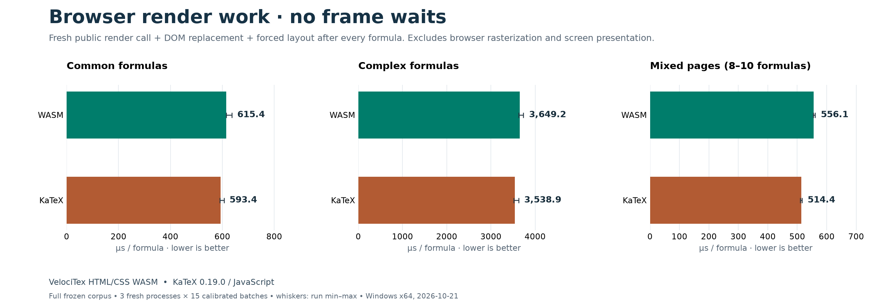
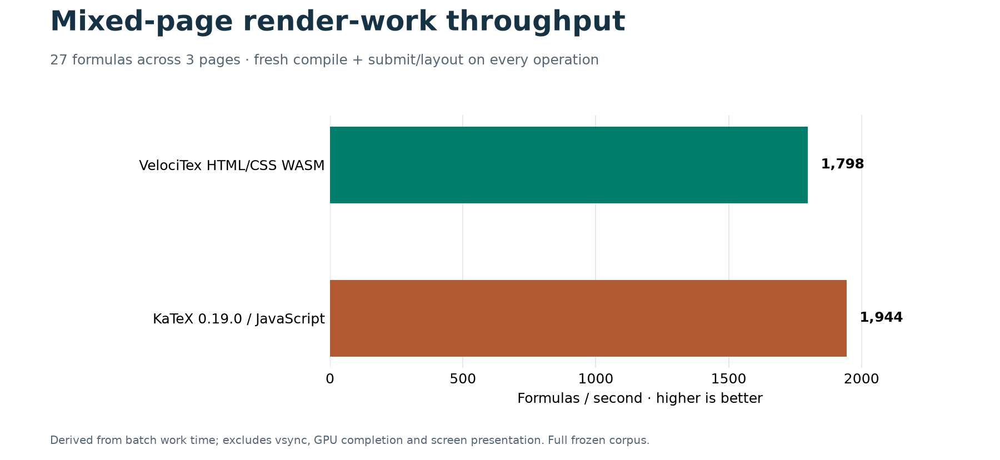
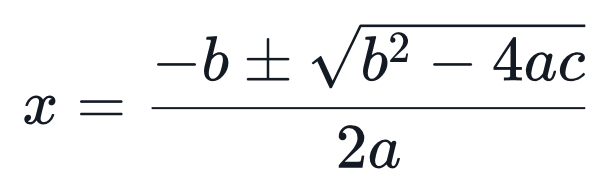
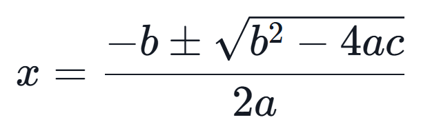
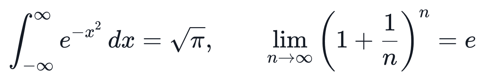
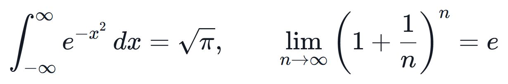
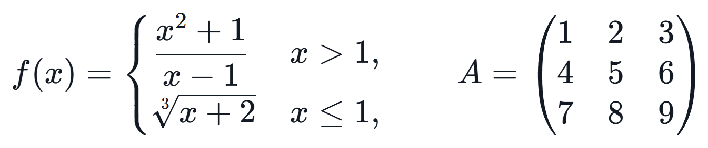
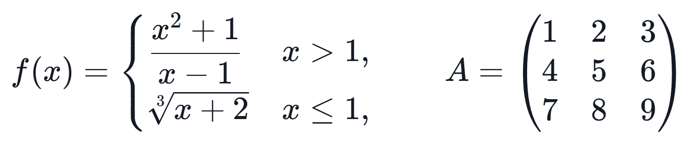
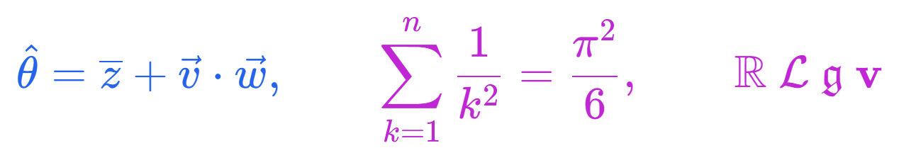
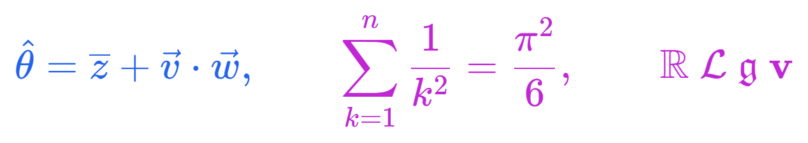

# HTML/CSS benchmarks · 2026-10-21

## Performance

2026-10-21 · Windows x64 · Release · KaTeX 0.19.0 · µs/formula (lower is better).

Both browser engines generate default HTML with accessibility MathML, using the same locked KaTeX CSS and fonts. Every benchmark formula is checked for byte-identical markup before timing.

Correctness validation passed for 3,659 valid core HTML/MathML fixtures and 46 browser integration formulas, including bundled stylesheet and font loading.

| Workload         | WASM HTML generation | KaTeX HTML generation | WASM DOM + layout | KaTeX DOM + layout |
| ---------------- | -------------------: | --------------------: | ----------------: | -----------------: |
| Common formulas  |                 43.4 |                  44.5 |             615.4 |              593.4 |
| Complex formulas |                426.2 |                 431.8 |            3649.2 |             3538.9 |
| Mixed pages      |                 44.9 |                  40.7 |             556.1 |              514.4 |

WASM/KaTeX relative throughput is **0.91–1.03×** for HTML generation and **0.93–0.97×** for DOM render work on this machine. Ratios below 1 mean WASM is slower.

All 36 formula occurrences are retained: 6 common, 3 complex, and 27 across three mixed pages. Three fresh processes × 15 calibrated batches per case; each case warms for at least 200 ms. Public async WASM API overhead is included. DOM timing forces layout after every formula. Startup, download, browser rasterization, GPU completion and screen presentation are excluded. Native C++/.NET/WinUI results and MathML serialization are separate diagnostics; the C++ Core does not expose this HTML generator.

[Methodology and reproduction](../benchmarks/README.md).

## Rendering comparison

Actual output at 32 px math em and 2× capture resolution. The WASM column uses the current default HTML/CSS renderer and bundled fonts. All four previews have matching computed styles and dimensions in their visible HTML trees. Three have byte-identical markup; the combined color example differs in CSS declaration order and a redundant inherited color declaration. Captures are not asserted pixel-identical. Cells in each row share a canvas and scale. Native uses DirectWrite/Direct2D.

| Formula                | Windows native / Direct2D                                                                             | VelociTex HTML/CSS WASM                                                                           | KaTeX 0.19.0                                                                                        |
| ---------------------- | ----------------------------------------------------------------------------------------------------- | ------------------------------------------------------------------------------------------------- | --------------------------------------------------------------------------------------------------- |
| Algebra                |                  |                  |                  |
| Calculus               |                |                |                |
| Piecewise & matrices   |  |  |  |
| Color, accents & fonts |     |     |     |

Source: `475c5d75fb699ec26419838ba5a9876076d3dc6e` plus the hashed harness changes in the [campaign manifest](../benchmarks/results/2026-10-21-html-css/manifest.json). [All raw batches and summary](../benchmarks/results/2026-10-21-html-css/benchmark-summary.json). Historical preview6 MathML-path results remain in `benchmarks/results/2026-10-20-preview6`.

[Rendering validation, including the color serialization difference](../benchmarks/results/2026-10-21-html-css/rendering-validation.json). [Combined rendering preview](benchmarks/rendering/comparison-preview.png).

Environment: 12th Gen Intel(R) Core(TM) i5-12400F, 31.8 GiB RAM; Windows_NT 10.0.26200 x64; `Mozilla/5.0 (Windows NT 10.0; Win64; x64) AppleWebKit/537.36 (KHTML, like Gecko) HeadlessChrome/155.0.0.0 Safari/537.36`.

## Native and MathML diagnostics

Native output contracts remain MathML, laid-out documents and SVG/Direct2D. These are not HTML-generation comparisons. All values are µs/formula.

| Workload         | C++ ABI MathML | .NET MathML | WASM MathML | KaTeX MathML | Native WinUI work |
| ---------------- | -------------: | ----------: | ----------: | -----------: | ----------------: |
| Common formulas  |           22.4 |        23.5 |        17.2 |         12.7 |            1228.3 |
| Complex formulas |          188.3 |       189.2 |       125.5 |         94.7 |           10624.9 |
| Mixed pages      |           18.0 |        19.3 |        13.6 |         10.2 |             365.2 |

## Per-case browser results

Units: µs/complete formula or complete page (page values are not divided by formula count).

| Input              | Formulas | WASM HTML | KaTeX HTML | WASM DOM + layout | KaTeX DOM + layout |
| ------------------ | -------: | --------: | ---------: | ----------------: | -----------------: |
| single-energy      |        1 |      14.5 |       14.0 |             221.4 |              199.8 |
| single-quadratic   |        1 |      41.3 |       44.4 |             641.3 |              611.6 |
| single-gaussian    |        1 |      51.2 |       51.2 |             683.4 |              619.8 |
| single-binomial    |        1 |      55.4 |       60.3 |             794.2 |              776.2 |
| single-determinant |        1 |      46.5 |       45.6 |             606.0 |              561.8 |
| single-derivative  |        1 |      51.1 |       52.7 |             760.8 |              800.0 |
| long-aligned       |        1 |     603.4 |      698.8 |            5083.1 |             4920.6 |
| long-cases         |        1 |     283.9 |      269.9 |            2715.6 |             2621.2 |
| long-maxwell       |        1 |     401.5 |      332.5 |            3148.7 |             3076.6 |
| page-algebra       |       10 |     421.9 |      371.4 |            5150.6 |             4746.3 |
| page-calculus      |        9 |     430.1 |      391.6 |            5233.1 |             4734.4 |
| page-physics       |        8 |     361.6 |      332.0 |            4681.2 |             4313.8 |
