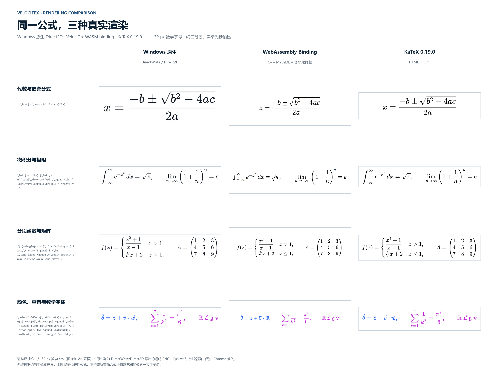

# 性能基准：Windows 原生、WASM Binding 与 KaTeX

本页记录 2026-10-20 在 Windows x64 上对三条渲染路径做的同一语料对比。原始
JSON、复现脚本和完整方法在 [benchmarks/README.md](../benchmarks/README.md)；
原始报告在 [benchmarks/results/2026-10-20](../benchmarks/results/2026-10-20)。

## 结论摘要

- **解析到 MathML**：Windows 原生在单个公式（0.096 ms）和超长公式（0.646 ms）
  上最快；KaTeX 在单个公式上接近（0.085 ms），超长公式为 0.520 ms；WASM
  binding 为 0.195 ms / 0.425 ms，其中超长公式混合了 C++ 快速路径与 `cases`
  的 C# 精确回退。
- **解析到 SVG**：WASM binding 在三种负载上均快于 Windows 原生导出
  （0.370 / 0.900 / 0.171 ms，对 0.465 / 2.046 / 0.364 ms）。KaTeX 0.19.0
  不提供原生 SVG 输出。
- **调用到屏幕呈现**：浏览器两路径都稳定在约 32 ms/公式，受 60 Hz 合成节拍限制；
  Windows 原生为约 64 ms/公式，但该会话的合成节拍是 31.5 ms（30 Hz），若按
  60 Hz 折算约为 32 ms。**不能把本机原生的 2× 差异解释为排版或绘制工作更慢。**
- **同步提交耗时**（不含帧等待）原生为 0.52 / 1.00 / 0.46 ms；WASM 为
  2.04 / 5.73 / 1.05 ms；KaTeX 为 2.06 / 10.18 / 0.89 ms。
- **整页吞吐**（约 9 条公式的图文混排）：WASM 280 公式/秒、KaTeX 280 公式/秒、
  原生 139 公式/秒（同样受 30 Hz 帧节拍影响）。

## 图表

### 解析与呈现

### 不含帧等待的同步渲染工作

### 图文混排页面吞吐

## 渲染效果对比

四组代表性公式均以 32 px 数学字号输出：原生为 Direct2D 透明 PNG 白底合成，
浏览器列来自无头 Chrome 的实际截图。纯白背景、统一边框与留白，便于直接比较
字形、间距和数学结构。

## 方法

| 指标         | 计时边界                                                                                                                |
| ------------ | ----------------------------------------------------------------------------------------------------------------------- |
| MathML 解析  | 完整 LaTeX 源到 presentation MathML；不含 DOM、布局与合成帧                                                             |
| SVG 解析     | 完整 LaTeX 源到自包含 SVG；不含 DOM 与合成帧                                                                            |
| 同步呈现调用 | 原生：`TryCompile` + `MathView.Result` 赋值返回；浏览器：`render` Promise 完成                                          |
| 调用到屏幕   | 从渲染调用开始，到第二次 `CompositionTarget.Rendering` / 第二个 `requestAnimationFrame`，已包含解析、布局、提交与帧节拍 |
| 整页         | 约 9 条公式与正文混排，计时覆盖整页的编译与提交，再等待呈现帧                                                           |

工作负载是冻结的 [workloads.json](../benchmarks/workloads.json)：

- **单个公式**：6 条常见公式（质能方程、求根公式、高斯积分、二项式、行列式、
  导数定义）。
- **超长公式**：3 条复杂单公式块（多行 aligned、cases 与嵌套根式、矩阵与
  Maxwell 方程组）。
- **图文混排页面**：3 页、每页 8–10 条公式，公式与中英文正文交错。

所有路径先做充分预热；每个指标记录 P50/P95/P99、最大值和均值。原生为
Release x64（.NET 10.0.13），浏览器为 Headless Chrome 155，KaTeX 固定
0.19.0。测试机：Intel Xeon Platinum，2 核 4 线程，8 GB 内存，Windows 10.0.20348，
无独立 GPU。原生窗口在本机会话中的合成节拍为 31.5 ms；浏览器为 16.7 ms。

## 限制

- 帧节拍不同导致“调用到屏幕”不是同刷新率对比；请看同步耗时图和原始 JSON。
- KaTeX 没有 SVG 输出，SVG 面板只比较原生与 WASM。
- Windows 原生页面用 `TextBlock` 与内联 `MathView` 组成图文行；Core 不负责
  正文段落换行，这与库的首版边界一致。
- C++ MathML 快速路径目前不支持 `cases` 等需要伸缩围栏的环境，会自动回退到
  精确的 C# 路径；超长公式的 WASM 数字包含这条回退路径。
- 数值只代表本机、本语料和本次构建；不构成对所有输入、浏览器或硬件的承诺。
