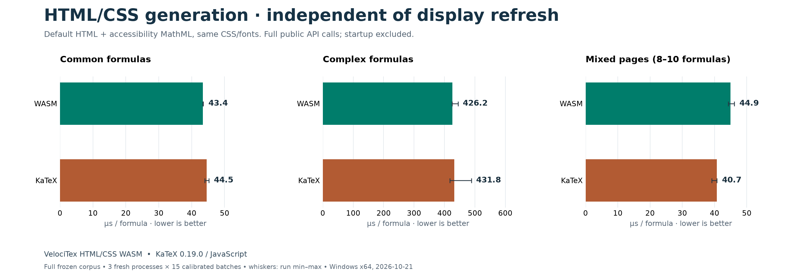
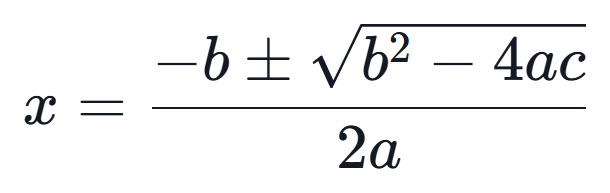
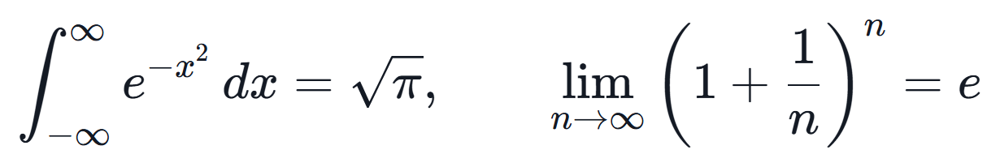
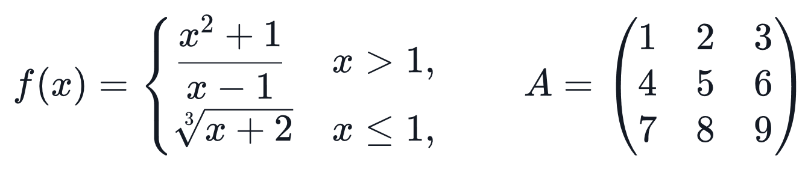

# VelociTex for the web

Render math with a standalone WebAssembly engine that emits the **same HTML and
MathML as KaTeX 0.19.0** for the supported core formula set and uses the locked KaTeX stylesheet and fonts. The API
is inspired by KaTeX, with asynchronous initialization. It is not a drop-in
replacement for all KaTeX options or extensions. This is an early browser preview.

<!-- benchmark:start -->

## Performance

2026-10-21 · Windows x64 · Release · KaTeX 0.19.0 · µs/formula (lower is better).

Both browser engines generate default HTML with accessibility MathML, using the same locked KaTeX CSS and fonts. Every benchmark formula is checked for byte-identical markup before timing.

Correctness validation passed for 3,659 valid core HTML/MathML fixtures and 46 browser integration formulas, including bundled stylesheet and font loading.

| Workload         | WASM HTML generation | KaTeX HTML generation | WASM DOM + layout | KaTeX DOM + layout |
| ---------------- | -------------------: | --------------------: | ----------------: | -----------------: |
| Common formulas  |                 43.4 |                  44.5 |             615.4 |              593.4 |
| Complex formulas |                426.2 |                 431.8 |            3649.2 |             3538.9 |
| Mixed pages      |                 44.9 |                  40.7 |             556.1 |              514.4 |

WASM/KaTeX relative throughput is **0.91–1.03×** for HTML generation and **0.93–0.97×** for DOM render work on this machine. Ratios below 1 mean WASM is slower.




All 36 formula occurrences are retained: 6 common, 3 complex, and 27 across three mixed pages. Three fresh processes × 15 calibrated batches per case; each case warms for at least 200 ms. Public async WASM API overhead is included. DOM timing forces layout after every formula. Startup, download, browser rasterization, GPU completion and screen presentation are excluded. Native C++/.NET/WinUI results and MathML serialization are separate diagnostics; the C++ Core does not expose this HTML generator.

[Methodology and reproduction](https://github.com/TaiRuiQu/VelociTex/blob/v1.0.0-preview7/benchmarks/README.md).

## Rendering comparison

Actual output at 32 px math em and 2× capture resolution. The WASM column uses the current default HTML/CSS renderer and bundled fonts. All four previews have matching computed styles and dimensions in their visible HTML trees. Three have byte-identical markup; the combined color example differs in CSS declaration order and a redundant inherited color declaration. Captures are not asserted pixel-identical. Cells in each row share a canvas and scale. Native uses DirectWrite/Direct2D.

| Formula                | Windows native / Direct2D                                                                         | VelociTex HTML/CSS WASM                                                                       | KaTeX 0.19.0                                                                                    |
| ---------------------- | ------------------------------------------------------------------------------------------------- | --------------------------------------------------------------------------------------------- | ----------------------------------------------------------------------------------------------- |
| Algebra                |                  |                  |                  |
| Calculus               |                |                |                |
| Piecewise & matrices   |  |  |  |
| Color, accents & fonts |     |     |     |

<!-- benchmark:end -->

## Install and use

Install the browser preview from npm:

```sh
npm install velocitex@next
```

For Vite or another bundler, copy the runtime as static assets:

```sh
npx velocitex-copy-assets public/velocitex
```

```html
<p>Inline: \(E=mc^2\).</p>
<div data-math="\int_0^1 x^2\,dx" data-display-mode="true"></div>
```

```js
import { init, renderAll } from 'velocitex';

// Set this to your public assets URL, including any deployment subpath.
await init({ assetBaseUrl: '/velocitex/' });
await renderAll();
```

Copy assets again whenever you update the package. Keep dotnet.js and every
hashed sibling from the same build together. Serve `.wasm` as `application/wasm`
and `.js` as JavaScript. No COOP/COEP headers are required: this build uses one
thread. Use HTTP(S), not `file://`.

When serving the package's `dist/` directory directly, initialization finds the
adjacent `runtime/` automatically:

```html
<script type="module">
  import { renderAll } from './dist/index.mjs';
  await renderAll();
</script>
```

The default HTML path downloads `runtime/vt-katex-html.wasm` (about 1.2 MB) and
`runtime/katex.min.css` plus the bundled fonts. It does **not** start the .NET
runtime. The stylesheet is injected automatically on first use unless
`init({ injectStyles: false })` is passed; `stylesheetUrl()` returns the injected
URL after initialization.

## Fast HTML path

`render` and `renderToString` use the KaTeX-compatible WebAssembly engine by
default for `html` and `mathml` output. The engine performs parsing, macro
expansion, HTML/MathML construction and serialization in one call and returns the
same markup as `katex.renderToString`. The default returns KaTeX's
`htmlAndMathml` output; `output: 'html'` returns its HTML-only markup and
`output: 'mathml'` returns KaTeX's `<span class="katex"><math …>` wrapper.

Set `fastHtml: false` (or the legacy `fastMathml: false`) or `output: 'svg'` to
force the full-Core SVG contract, which includes a visually hidden semantic
MathML copy and needs the bundled .NET WASM runtime. Invalid formulas still
return `ParseError`; with `throwOnError: false` the engine returns KaTeX's own
readable error markup.

## APIs

```js
import velocitex, { render, renderToString, ParseError } from 'velocitex';

await render(String.raw`\frac{a}{b}`, document.querySelector('#formula'));
const html = await renderToString(String.raw`\sqrt{x}`, { displayMode: true });
const svg = await renderToString('x^2', { output: 'svg' });
const mathml = await renderToString('x^2', { output: 'mathml' });
const report = await velocitex.renderAll(document.querySelector('#article'));
console.log(report.rendered, report.errors);
```

- `init({ assetBaseUrl? })`: optional when the runtime is beside the ES module;
  shared by concurrent calls. Call before rendering to override the asset URL.
- `render(source, element, options?)`: replaces the element's contents.
- `renderToString(source, options?)`: returns KaTeX-identical HTML by default.
  `output: 'mathml'` selects KaTeX's MathML wrapper; `output: 'svg'` and
  `fastHtml: false` / `fastMathml: false` select the full-Core SVG contract.
- `renderAll(root = document.body, options?)`: scans `[data-math]` elements and
  text containing `$$…$$`, `\[…\]`, or `\(…\)`. Repeated calls skip rendered
  output. `data-math` supplies TeX; a custom `selector` can use element text.
  `data-display-mode="true"` enables display math, `"false"` inline math.

`renderAll` skips code, pre, scripts, style, textareas, SVG, MathML,
contenteditable regions and `.velocitex-ignore`. Delimiters must be within a
single text node. Escaped delimiters and braces are respected. It does not
observe future DOM changes; call it again after adding new content. Single `$`
is opt-in to avoid interpreting currency:

```js
await renderAll(document.body, {
  delimiters: [
    { left: '$$', right: '$$', display: true },
    { left: '$', right: '$', display: false },
  ],
});
```

`render` and `renderToString` throw `ParseError` for invalid TeX by default.
Use `{ throwOnError: false }` to display safely escaped original source in the
error color. `renderAll` defaults to this behavior and returns structured errors
with `source`, `error.code`, `error.range` (UTF-16) and the affected element.
Infrastructure errors and invalid JS arguments still reject the Promise.

Supported options are declared in `index.d.ts`: `fontSize` (CSS pixels, default
24), `displayMode`, string `macros`, `strict`, `maxExpand`, input/node/token/nesting
limits, `maxSize`, `minRuleThickness`, `colorIsTextColor`, `leqno`, `fleqn`,
`displayWidth`, `output`, `throwOnError`, `errorColor`. Resource budgets remain
enforced by Core. `renderAll` additionally limits each call to 1,000 formulas
(configurable up to 10,000). Successful earlier formulas can remain if a later
formula exceeds this bound.

Macros are isolated per formula: no implicit cross-formula definition mutation
or JS callback macros. There is no `trust`, HTML injection, external images,
links, mhchem, body-text layout, automatic formula line breaking, Node.js SSR,
or structural spoken-math navigation. Source is retained as
`data-velocitex-source`; partial visual text selection is not implemented.

**Font fallback:** the KaTeX-compatible HTML path uses the unchanged KaTeX fonts
and stylesheet, including KaTeX's CJK/Arabic/etc. fallback classes. `\text{}`
with ordinary CJK text therefore matches KaTeX in the browser. The legacy
full-Core SVG path (`fastHtml: false`) has no DirectWrite shaper in a browser;
missing glyphs there return `UnknownSymbol` or readable original source when
`throwOnError: false`. Full Windows fallback compatibility is not claimed.

Supported formulas use the standalone KaTeX-compatible WebAssembly HTML path.
Other inputs load the bundled .NET WASM AOT runtime. End users need neither the
SDK nor Node.js in the browser. Deploy all runtime assets together when
upgrading the package.

Code is MIT. The HTML engine vendors a patched `katex-rs` under MIT; see
`licenses/katex-rs-LICENSE.txt`. Bundled unchanged KaTeX fonts and their extracted
contours retain OFL-1.1 and Reserved Font Name terms; see
`licenses/KaTeX-FONTS-OFL.txt`. .NET runtime third-party notices are retained with
the distribution.
